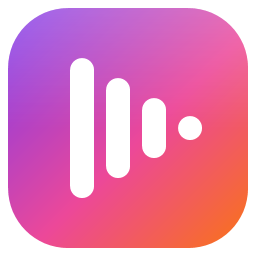
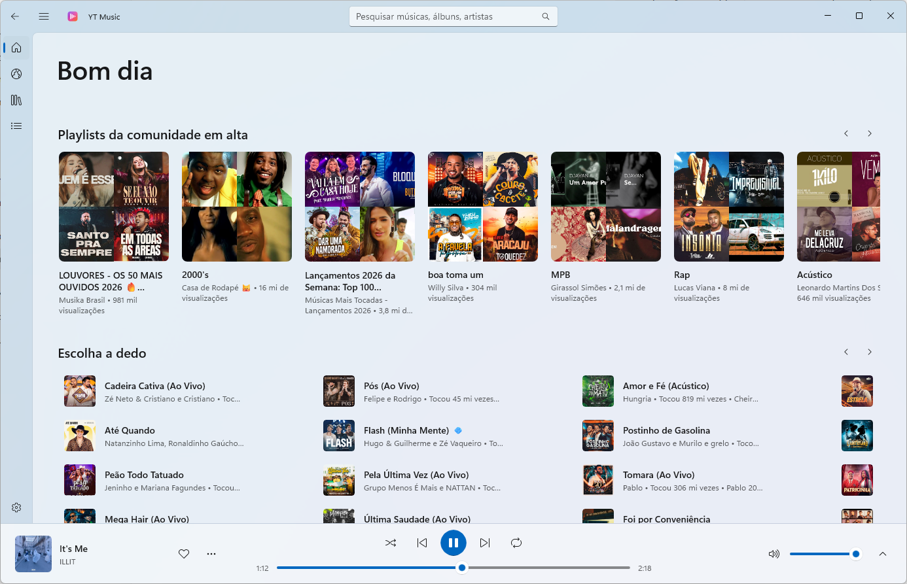
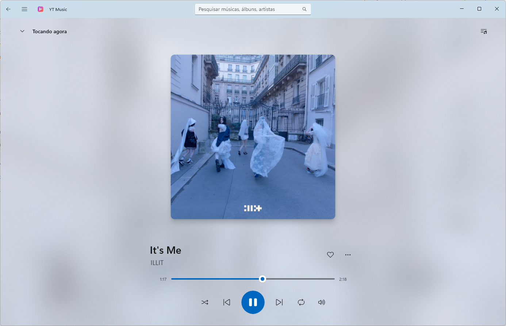
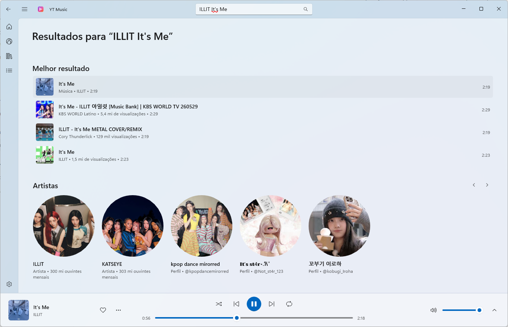
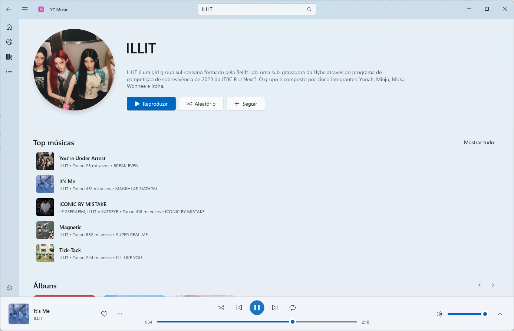
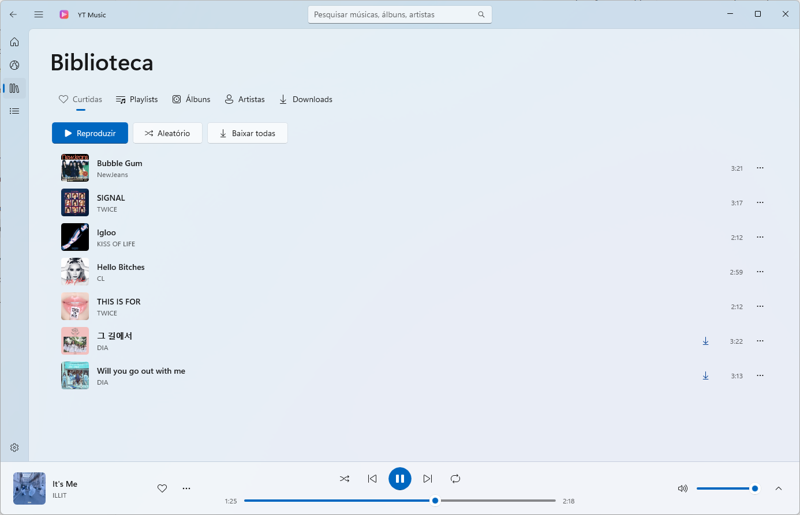
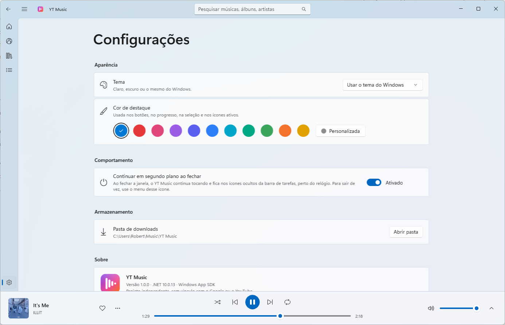

# YT Music for Windows

A native music player for Windows 11 and 10 with Fluent Design, 
smooth animations and everything you expect: a library, playlists and offline music.

**[Website](https://robertss97.github.io/YT-Music/en/)** · **[Português](README.md)**

 

## Features

### 🎧 Playback
- **Play anything** from the YouTube Music catalog in high quality.
- **"Now playing" screen** with large artwork, a blurred backdrop and the *Up next* queue.
- **Automatic radio**: start a song and the queue fills with similar tracks.
- **Full queue control**: play next, add to queue, drag to reorder, remove.
- Shuffle, repeat (all / one), volume and a seek bar with time preview.
- **Resumes where you left off**: after reopening (even after a reboot) your last song comes back paused at the same point, with the whole queue.

### 🔎 Discover
- **Home** with recommendations, new releases and trending playlists, plus **Explore**.
- **Search** with suggestions as you type and your recent searches.
- **Artist pages** with top songs, albums, singles and videos — and **"See all"** for the full discography.
- **Album and playlist pages** with play all and shuffle.
- Click the artist name or use **"Go to artist" / "Go to album"** on any track.

### 📚 Your library
- **Likes** with the heart in the player or any track menu.
- **Your own playlists**: create, rename, delete and drag to reorder.
- **Save albums and playlists** and **follow artists**.
- Everything is stored on your PC — no account needed.

### ⬇️ Offline music
- **Download songs, whole playlists or all your likes** to listen without internet.
- Files go to `Music\YT Music` as **.m4a** and play in any other player too.
- Download progress is always visible in the title bar.

### 🎨 Make it yours
- **Theme**: light, dark or follow Windows.
- **Accent color**: Windows', 10 presets or any color you pick.
- Remembers the window size, collapsed sidebar, volume and the *Up next* panel.

### 🪟 Built into Windows
- **Media keys**, lock screen and Windows volume flyout controls.
- **Keeps playing in the background** when you close the window, from the system tray.
- Shortcuts: `Ctrl+F` search · `Ctrl+Space` play/pause · `Ctrl+→` / `Ctrl+←` next/previous.

> The interface is in Brazilian Portuguese.

## Screenshots

| Now playing | Search |
|:---:|:---:|
|  |  |
| **Artist** | **Library** |
|  |  |

## Install

1. Download **`YTMusic-Setup-x.y.z-x64.msi`** from the [releases page](https://github.com/RobertSS97/YT-Music/releases/latest).
2. Double-click it and follow the wizard. The app is installed to *Program Files* with **Start menu** and **desktop** shortcuts.
3. Done — nothing else to install (.NET and the Windows components are included).

> [!NOTE]
> The installer isn't signed with a paid certificate, so Windows may show **"Windows protected your PC"**.
> Click **More info → Run anyway** to continue.

**Update:** download the new version and install it over the old one — your library is kept.

**Uninstall:** *Settings → Apps → YT Music → Uninstall*. Your library and downloaded songs are kept.

### Requirements
- Windows 11 or Windows 10 (version 2004 or later), 64-bit (x64)
- Internet connection for streaming (downloaded songs play offline)

## Disclaimer

YT Music is an **independent project**, not affiliated with Google or YouTube. It uses public YouTube Music
services that may change without notice — if something stops working, a new version may be needed.
Use it for personal listening and respect artists' rights.

This repository only distributes the installer. Found a bug or have an idea?
[Open an issue](https://github.com/RobertSS97/YT-Music/issues).
