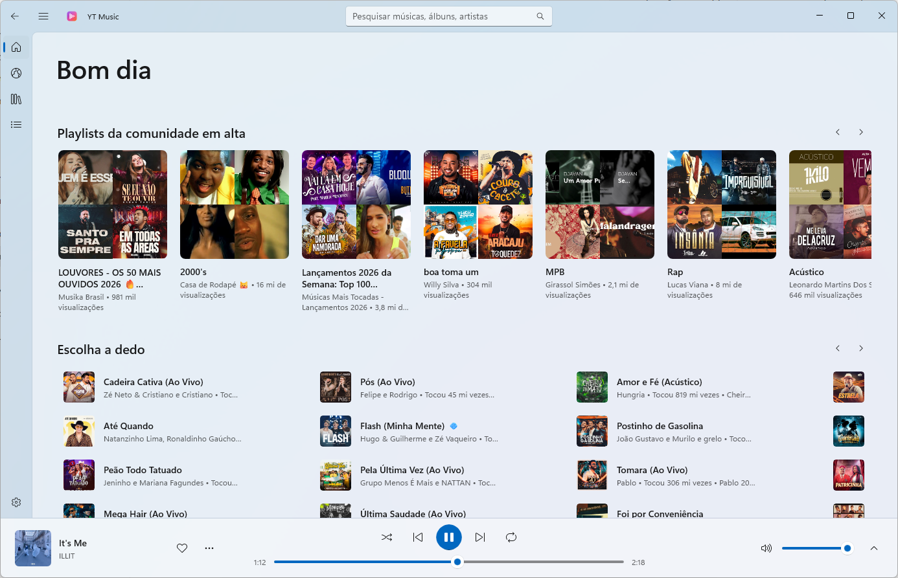
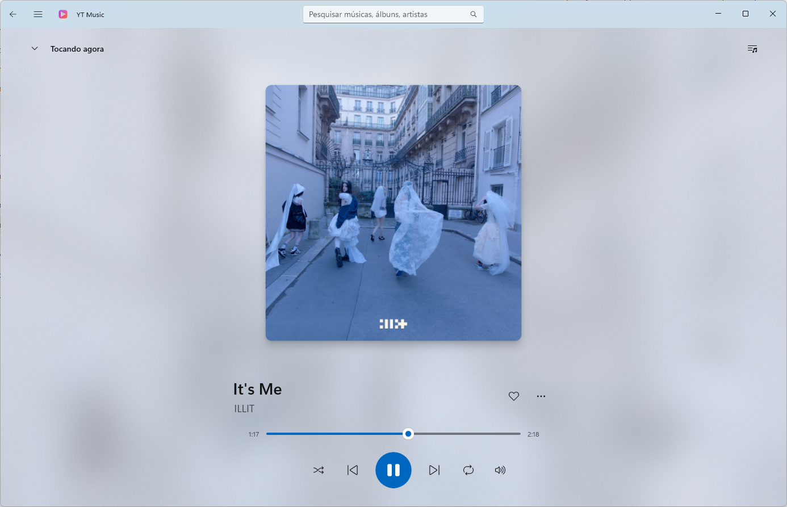
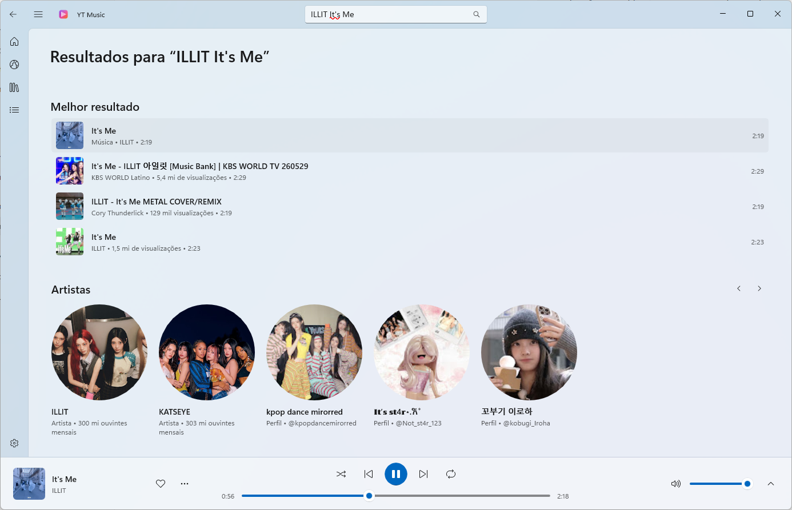
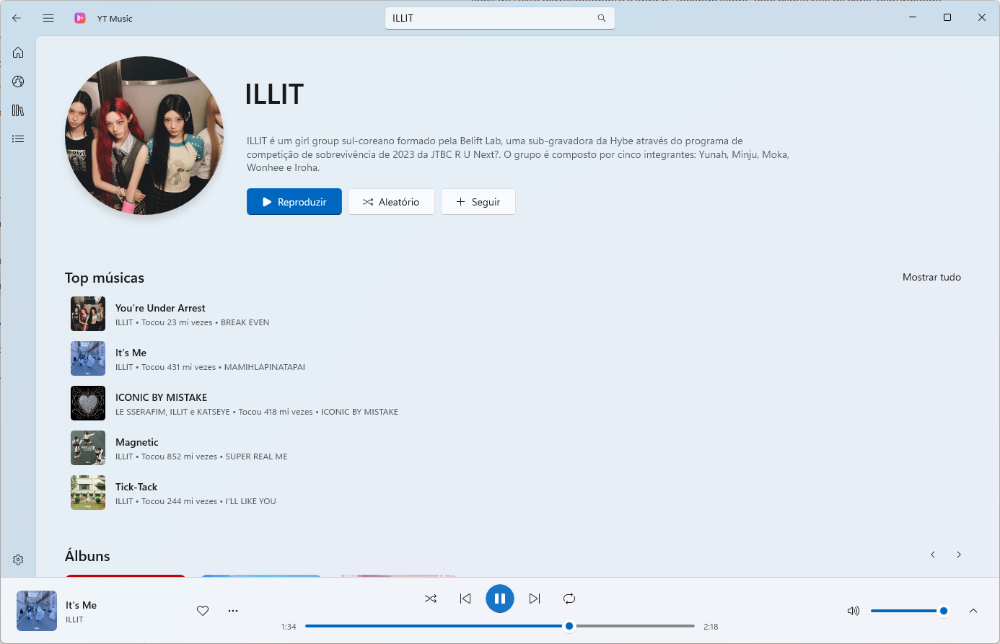
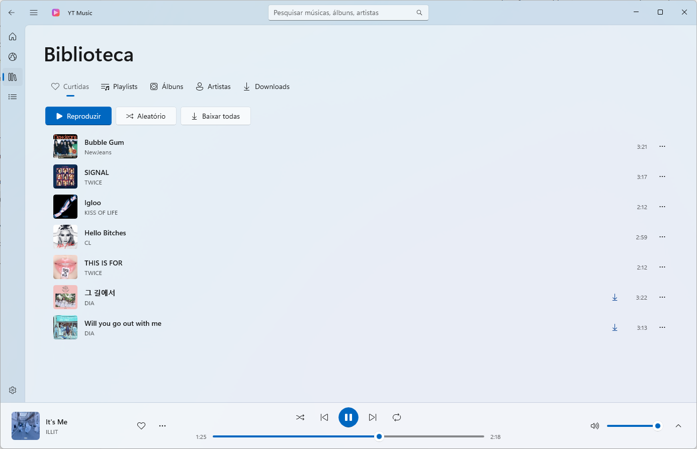
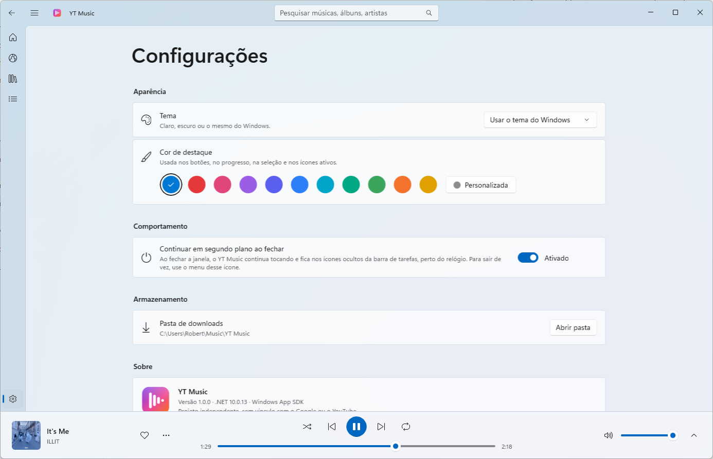

# YT Music para Windows

Um player de música nativo para Windows 11 e 10, com o visual do Fluent Design, 
animações suaves e tudo o que você espera: biblioteca, playlists e música offline.

**[Site](https://robertss97.github.io/YT-Music/)** · **[English](README.en.md)**

 

## Recursos

### 🎧 Reprodução
- **Toca qualquer música** do catálogo do YouTube Music, com áudio em alta qualidade.
- **Tela "Tocando agora"** com a capa em destaque, fundo desfocado com a própria arte e a fila *A seguir*.
- **Rádio automático**: ao tocar uma música, a fila se enche de faixas parecidas.
- **Fila completa**: tocar a seguir, adicionar à fila, reordenar arrastando e remover faixas.
- Aleatório, repetir (tudo / uma), controle de volume e barra de progresso com prévia do tempo.
- **Continua de onde parou**: ao abrir de novo (até depois de desligar o PC), a última música volta pausada no mesmo ponto, com a fila inteira.

### 🔎 Descobrir
- **Início** com recomendações, lançamentos e playlists em alta.
- **Explorar** novidades e o que está em alta.
- **Busca** com sugestões enquanto você digita e histórico das últimas pesquisas.
- **Páginas de artista** com top músicas, álbuns, singles e vídeos — e **"Ver tudo"** para a discografia completa.
- **Páginas de álbum e playlist** com tocar tudo e aleatório.
- Clique no nome do artista ou use **"Ir para o artista" / "Ir para o álbum"** em qualquer faixa.

### 📚 Sua biblioteca
- **Curtidas**: um coração no player e no menu de qualquer faixa.
- **Playlists próprias**: crie, renomeie, exclua e reordene as músicas arrastando.
- **Salve álbuns e playlists** e **siga artistas** para encontrá-los rápido.
- Tudo fica salvo no seu computador, sem precisar de conta.

### ⬇️ Música offline
- **Baixe músicas, playlists inteiras ou todas as curtidas** para ouvir sem internet.
- Os arquivos vão para `Músicas\YT Music` em **.m4a**, que tocam em qualquer outro player.
- Progresso do download sempre visível na barra de título.

### 🎨 Do seu jeito
- **Tema** claro, escuro ou igual ao do Windows.
- **Cor de destaque**: a do Windows, 10 cores prontas ou qualquer cor que você escolher.
- Lembra o tamanho da janela, o menu lateral recolhido, o volume e o painel *A seguir*.

### 🪟 Integrado ao Windows
- **Teclas de mídia**, controles na tela de bloqueio e no painel de volume do Windows.
- **Continua tocando em segundo plano** ao fechar a janela, com ícone nos ícones ocultos perto do relógio.
- Atalhos: `Ctrl+F` buscar · `Ctrl+Espaço` tocar/pausar · `Ctrl+→` / `Ctrl+←` próxima/anterior.

## Capturas de tela

| Tocando agora | Busca |
|:---:|:---:|
|  |  |
| **Artista** | **Biblioteca** |
|  |  |

## Instalação

1. Baixe o arquivo **`YTMusic-Setup-x.y.z-x64.msi`** na [página de versões](https://github.com/RobertSS97/YT-Music/releases/latest).
2. Dê um duplo clique e siga o assistente. O programa é instalado em *Arquivos de Programas* e ganha atalhos no **Menu Iniciar** e na **Área de Trabalho**.
3. Pronto — não precisa instalar mais nada (o .NET e os componentes do Windows já vão junto).

> [!NOTE]
> Como o instalador não tem assinatura digital paga, o Windows pode mostrar **"O Windows protegeu o computador"**.
> Clique em **Mais informações → Executar assim mesmo** para continuar.

**Atualizar:** baixe a versão nova e instale por cima — a anterior é substituída e nada da sua biblioteca se perde.

**Desinstalar:** *Configurações → Aplicativos → YT Music → Desinstalar*. Sua biblioteca e as músicas baixadas são mantidas.

### Requisitos
- Windows 11 ou Windows 10 (versão 2004 ou mais recente), 64 bits (x64)
- Conexão com a internet para ouvir online (as músicas baixadas tocam offline)

### Onde ficam seus dados
| O quê | Onde |
|---|---|
| Curtidas, playlists, salvos e configurações | `%LOCALAPPDATA%\YTMusic` |
| Músicas baixadas | `Músicas\YT Music` |

## Aviso

O YT Music é um **projeto independente**, sem nenhum vínculo com o Google ou o YouTube. Ele usa serviços públicos
do YouTube Music que podem mudar sem aviso — se algo parar de funcionar, uma versão nova pode ser necessária.
Use para ouvir música de forma pessoal e respeite os direitos dos artistas.

Este repositório distribui apenas o instalador. Encontrou um problema ou tem uma sugestão?
[Abra uma issue](https://github.com/RobertSS97/YT-Music/issues).
